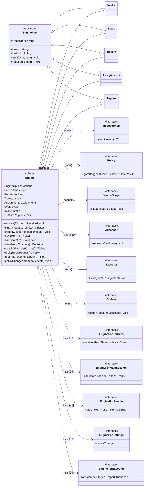
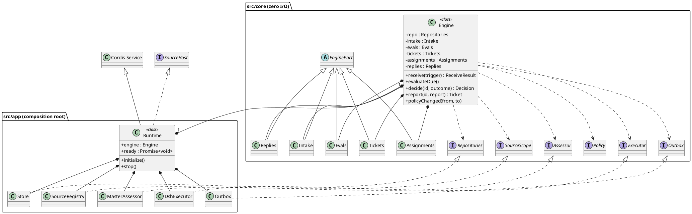

# Engine / Runtime UML — dsh-superagent-prototype

> 源码基准：`/Users/xleo/Agent/way2sa/dsh-superagent-prototype`（发布版研究原型；仓库 README 明确写了「与长文/内部版不完全相同，部分设计未落地」）。
> 本文每条断言都带 `file:line`，行号以当前工作树为准。配套渲染页：`engine-runtime-uml.html`（自包含，可直接用 `file://` 或 Shan 预览打开）。
> 对话里的三张内联图分别是：Engine 类图、Runtime 类图、端口装配图；本文是可编辑的 Mermaid 版本。
> **延伸**：Engine 内部的 5 个 `EnginePart` 子类与 `Repositories` 端口见同目录 `PARTS-UML.md` / `parts-uml.html`。

---

## 0. 一句话定位

| | Engine | Runtime |
| --- | --- | --- |
| 层次 | `src/core/` 领域核心 | `src/app/` 应用组合根 |
| 定义 | `src/core/engine.ts:24` | `src/app/runtime.ts:59` |
| 职责 | **唯一的事务性写入口** | 装配全部组件、启动、注册 HTTP、优雅停机 |
| 知道 I/O 吗 | **不知道**，只认 `core/ports.ts` 的 6 个接口 | 知道 SQLite、Cordis、GitHub、飞书、agent session |
| 被谁创建 | `src/app/runtime.ts:137` `new Engine({...})` | `src/index.ts:21` `new Runtime(ctx, machine, restart)` |
| 生命周期 | 无独立生命周期，随 Runtime 存活 | `ready = initialize()`（`:167`）/ `stop()`（`:229`） |

一句话：**Engine 是「纯核心」，Runtime 是「唯一知道世界的地方」**。二者的接缝就是 `core/ports.ts`。

---

## 1. Engine 类图（Mermaid）



关键事实（逐条核对过源码）：

- `class Engine` — `src/core/engine.ts:24`；构造参数属性 `private readonly options: EngineOptions` — `:31`。
- 6 个私有 Part 字段 — `:25`–`:30`，在构造函数里按依赖顺序 `new` 出来 — `:32`–`:37`。
- **27 个 public 方法**，其中 **26 个**方法体里出现 `repo.atomic(...)`；唯一例外是只读查询 `candidate()` — `:90`。
- 5 个 `Pick<Engine, …>` 角色接口 — `:261`–`:269`。调用方拿到的是**窄接口**，不是整个 Engine。
- `EnginePart` 抽象基类 — `src/core/part.ts:26`；5 个子类分别在 `intake.ts:16` / `evals.ts:27` / `tickets.ts:29` / `assignments.ts:30` / `replies.ts:26`。
- `EngineOptions` — `src/core/part.ts:7`，是核心唯一的「配置漏斗」：repo / policy / scope / assessor / executor / outbox / prepareTicket / now / emit。

---

## 2. Runtime 类图（Mermaid）

```mermaid
classDiagram
direction LR
class Service {
  <<external>>
  Cordis Service
}
class SourceHost {
  <<interface>>
  +sources SourceRegistry
  +context(kind) SourceContext
}
class Runtime {
  <<class>>
  +Store store
  +Setup setup
  +Prompts prompts
  +Effects effects
  +SourceRegistry sources
  +Commands commands
  +Sessions sessions
  +Settings settings
  +DshExecutor executor
  +MasterAssessor assessor
  +Outbox outbox
  +Engine engine
  +Passes passes
  +Promise ready
  +string masterId
  -HealthBoard board
  -AbortController stopped
  -number quiet
  +constructor(ctx, machine, restart)
  +context(kind) SourceContext
  +configured() boolean
  +receive(Trigger) ReceiveResult
  +idle() Promise
  +pump() Promise
  +sendReplies() Promise
  +get health() Record
  +get lifetime() AbortSignal
  +get deployment() Deployment
  -initialize() Promise
  -httpHost() HttpHost
  +stop() Promise
  -shutdown() Promise
}
class Engine {
  <<class>>
  core/engine.ts:24
}
Service <|-- Runtime
SourceHost <|.. Runtime
Runtime "1" *-- "1" Engine : runtime.ts:137
Runtime "1" *-- "12" Store
Runtime "1" *-- "12" Setup
Runtime "1" *-- "12" Prompts
Runtime "1" *-- "12" Effects
Runtime "1" *-- "12" SourceRegistry
Runtime "1" *-- "12" Commands
Runtime "1" *-- "12" Sessions
Runtime "1" *-- "12" Settings
Runtime "1" *-- "12" DshExecutor
Runtime "1" *-- "12" MasterAssessor
Runtime "1" *-- "12" Outbox
Runtime "1" *-- "12" Passes
```

关键事实：

- `export class Runtime extends Service implements SourceHost` — `src/app/runtime.ts:59`；`SourceHost` 定义在 `src/sources/host.ts:23`，`Service` 来自 `@deepseek-ai/cordis`。
- 同一文件 `:47` 用 module augmentation 把 `orchestrator: SourceHost` 挂到 Cordis `Context` 上，所以 Source 插件只能经这个窄接口访问宿主。
- 13 个 `readonly` 公共字段 — `:60`–`:76`；私有状态（board、runtimeHealth、sourceLinks、stopped、disposers、releaseLock、closingFlag、stopping、sourceDeps、toolHost、quiet）— `:74`–`:86`。
- 构造函数 `:87`–`:168` 是**唯一的装配现场**：先 `mkdirSync` + `lockSync` 锁 state 目录（`:90`–`:93`），再依次 new 出 12 个组件，最后 `new Engine({...})`（`:137`）。
- `this.ready = this.initialize()` — `:167`；`initialize()` — `:201`，顺序是「注册 HTTP → 跑 setup → install sessions/executor → 确保主 Session → 同步策略 → resume / start / effects / health ready」。
- `stop()` — `:229` 幂等（`this.stopping ??= this.shutdown()`）；`shutdown()` — `:230` 先置 `closingFlag`、`stop()` passes、`stopped.abort()`，再取消 agent、`drain` effects、关 executor/sessions、反序 dispose、flush 持久化，**最后**才 `store.close()` 和释放目录锁。

---

## 3. 端口装配表（六边形架构的落点）

`new Engine({...})` 在 `src/app/runtime.ts:137`：

| `core/ports.ts` 接口 | 定义 | Runtime 注入的实现 | 声明 |
| --- | --- | --- | --- |
| `Repositories` | `ports.ts:106` | `Store`（`repo: store`） | `app/store.ts:51` `implements Repositories` |
| `Policy` | `ports.ts:17` | `settingsPolicy(store.settings(), sources)` | `policy.ts` / `runtime.ts:136` |
| `SourceScope` | `ports.ts:12` | `SourceRegistry`（`scope: sources`） | `sources/registry.ts:13` `implements SourceScope` |
| `Assessor` | `ports.ts:49` | `MasterAssessor` | `app/assessment.ts:89` `implements Assessor` |
| `Executor` | `ports.ts:59` | `DshExecutor` | `executor/dsh.ts:207` `implements Executor` |
| `Outbox` | `ports.ts:76` | `app/Outbox` | `app/outbox.ts:22` `implements OutboxPort` |

另有 `MemoryRepositories`（`core/memory.ts:10`）也 `implements Repositories` —— 这是测试用的内存实现，正好说明核心与存储是可替换的。

> 结论：`src/core/` 零 I/O 不是口号，是**编译期**约束。Engine 只能看见 `Repositories.atomic()` / `Policy.gate()` / `Executor.start()` / `Outbox.send()` 这些接口；SQLite、GitHub、飞书全在 `src/app/`、`src/sources/`、`src/executor/`。

---

## 4. Engine 完整方法清单（27 个）

按调用方分组，与 `engine.ts:261-269` 的 5 个角色接口一一对应。

| # | 行 | 签名 | 调用方 |
| --- | --- | --- | --- |
| 1 | 48 | `receive(trigger): ReceiveResult` | EngineForSources |
| 2 | 54 | `bindThread(ticketId, thread, own): Ticket` | EngineForSources |
| 3 | 62 | `threadClosed(thread, outcome, at): void` | EngineForSources |
| 4 | 75 | `evaluateDue(): void` | 时钟 / Passes |
| 5 | 90 | `candidate(triggerId): Candidate \| undefined` | EngineForMainSession（**唯一不走 atomic**） |
| 6 | 100 | `decide(triggerId, outcome): Decision` | EngineForMainSession |
| 7 | 109 | `attach(ticketId, triggerId, note?): Ticket` | EngineForMainSession |
| 8 | 127 | `requestStatus(ticketId): boolean` | EngineForMainSession |
| 9 | 135 | `reply(request): Reply` | MainSession + Executor |
| 10 | 140 | `candidateDelivered(evalId): void` | EngineForMainSession |
| 11 | 145 | `reevaluate(triggerId): boolean` | EngineForPeople |
| 12 | 150 | `dismiss(decisionId): Decision` | EngineForPeople |
| 13 | 155 | `unsubscribe(thread): boolean` | EngineForPeople |
| 14 | 160 | `stopTicket(ticketId, reason?): Ticket` | EngineForPeople |
| 15 | 166 | `retryTicket(ticketId): Ticket` | EngineForPeople |
| 16 | 174 | `assignmentStarted(ticketId, assignmentId): void` | EngineForExecutor |
| 17 | 181 | `inputsDelivered(ticketId, assignmentId, inputIds): void` | EngineForExecutor |
| 18 | 189 | `inputsRead(ticketId, inputIds): void` | EngineForExecutor |
| 19 | 193 | `turnEnded(ticketId, assignmentId): void` | EngineForExecutor |
| 20 | 197 | `deliveryFailed(ticketId, assignmentId, error): void` | EngineForExecutor |
| 21 | 206 | `markUnrelated(ticketId, thread, reason): void` | EngineForExecutor |
| 22 | 214 | `followForContext(ticketId, thread): boolean` | EngineForExecutor |
| 23 | 221 | `note(ticketId, text): Ticket` | EngineForMainSession |
| 24 | 227 | `handback(ticketId, triggerId, reason): boolean` | EngineForExecutor |
| 25 | 239 | `report(ticketId, report): Ticket` | EngineForExecutor |
| 26 | 245 | `assignmentInterrupted(ticketId, assignmentId): void` | EngineForExecutor |
| 27 | 255 | `policyChanged(from, to, effects?): void` | EngineForSettings |

---

## 5. Runtime 成员清单

| 类别 | 位置 | 成员 |
| --- | --- | --- |
| 公共组件 | `:60`–`:73` | `store` `setup` `prompts` `effects` `sources` `commands` `sessions` `settings` `executor` `assessor` `outbox` `engine` `passes` `ready` |
| 标识 | `:76` | `masterId` |
| 私有状态 | `:74`–`:86` | `board` `runtimeHealth` `sourceLinks` `stopped` `disposers` `releaseLock` `closingFlag` `stopping` `sourceDeps` `toolHost` `quiet` |
| getters | `:173`, `:175`, `:178`, `:180`, `:182` | `health` `lifetime` `deployment` `setupProblem` `feishuProblem` |
| SourceHost | `:176`, `:179`, `:183`, `:188`, `:193`–`:197` | `context` `configured` `links` `ticketEnvironment` `checkSetup` `receive` `idle` `pump` `sendReplies` |
| 内部 | `:198`, `:200`, `:201`, `:219` | `closing` `paused` `initialize` `httpHost` |
| 生命周期 | `:229`, `:230` | `stop` `shutdown` |

---

## 6. 关系语义（图例）

| 画法 | 含义 | 本例 |
| --- | --- | --- |
| 实线 + 空心三角 | 泛化 / 继承 | `EnginePart <\|-- Intake…`；`Service <\|-- Runtime` |
| 虚线 + 空心三角 | 实现 | `SourceHost <\|.. Runtime`；`Repositories <\|.. Store` |
| 实心菱形 | 组合（同生命周期） | `Runtime ◆— Engine`、`Engine ◆— 5 个 Part` |
| 虚线箭头 | 依赖 | `Engine ╌> 6 个端口` |
| 虚线箭头（投影） | 类型投影，非实现 | `Engine ╌> 5 个 Pick<> 角色接口` |

注意最后一行：**`EngineFor*` 不是 Engine 实现的接口**，而是 `Pick<Engine, …>` 构造出来的类型别名（`engine.ts:261-269`）。UML 上用「投影/依赖」比用 realization 更准确。

---

## 7. 从这两张图读出的设计决策

1. **核心与外壳分离**：`src/core/` 只依赖 `core/ports.ts` 里的接口，不 import 任何 `src/app/`、`node:fs`、SQLite 或网络库。Runtime 是唯一做 I/O 的地方。
2. **单一事务入口**：所有写操作都经 `Engine.xxx()` → `repo.atomic(() ⇒ part.xxx())`。领域状态的修改只有一个门，跨聚合改动由 Part 之间在同一个事务里委派（`part.ts:19-22` 的注释写得很清楚）。
3. **按角色收窄权限**：调用方拿不到整个 Engine，只拿到 `Pick<>` 出来的 3–11 个方法。这是**编译期的权限边界**，比运行时判断更可靠。
4. **副作用外置**：Engine 通过 `emit` 发领域事件、通过 `Outbox` / `Executor` / `Assessor` 排队副作用；`runtime.ts:138-150` 的 `emit` 回调才把事件翻译为主 Session 通知、followup 转发和 PR 结束通告。
5. **组合根承担生命周期**：目录锁、DB 开关、setup、HTTP 路由、策略同步、agent 取消、flush、释放锁，全在 Runtime 里按确定顺序发生；Engine 完全没有 `start()` / `stop()`。
6. **可替换存储**：`MemoryRepositories`（`core/memory.ts:10`）与 `Store`（`app/store.ts:51`）实现同一个 `Repositories`，是核心可测试性的直接证据。

---

## 8. 与课程 UML 目录的关系

`assets/uml.js` 里已有 `engine` / `runtime` 两个节点（供课件每个流程块点击弹 UML 用），但那里是**精简版**（各 3 个字段、5 个方法）。本文是完整版：

| | `assets/uml.js` | 本文 |
| --- | --- | --- |
| Engine 字段/方法 | 3 / 5 | 7 / 27 |
| Runtime 字段/方法 | 1 / 5 | 13+11 / 20+ |
| 端口与装配关系 | 无 | 6 组 implements 映射 |
| 用途 | 课件弹窗，一眼看懂 | 研究 / 复核 / 改代码前对图 |

如需让课件弹窗也显示完整成员，改 `assets/uml.js` 的这两个条目再 `node tools/build.mjs` 即可（该文件被内联进 9 个 `index.html`）。

---

## 9. 可复用的 PlantUML 源


