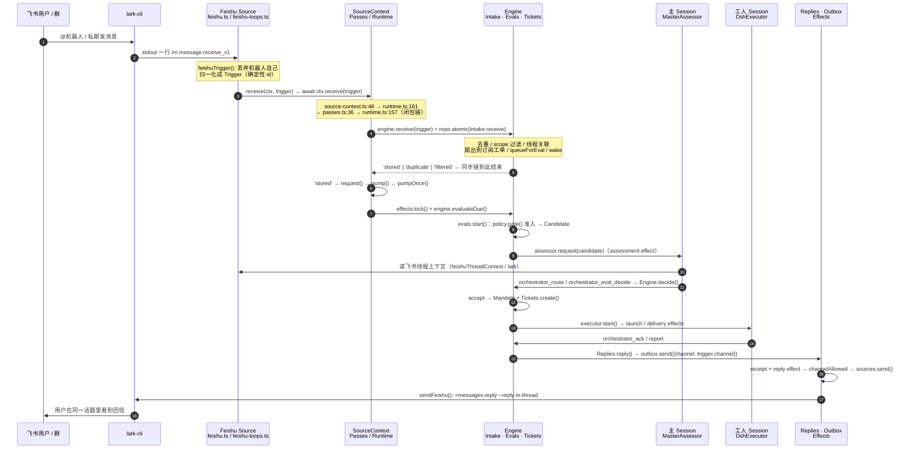

# 飞书消息的完整生命过程 — dsh-superagent-prototype

> **源码基准**：`/Users/xleo/Agent/way2sa/dsh-superagent-prototype`，git `6337fc8`。本文每条断言都带 `file:line`，行号以当前工作树为准。
> **配套动态页**：同目录 `feishu-message-lifecycle.html`（自包含，可直接 `file://` 打开，也可在 Shan 预览里播放）。
> **起点**：你给出的 `ctx.receive(trigger)` 闭包链。我逐条复核了，结论一致；只有 3 处行号偏移，见 §0.2。本文把这条「入核」链向前补到飞书事件、向后补到回信发回飞书，形成一条完整的生命线。
> **姊妹篇**：`ENGINE-RUNTIME-UML.md`（核心/组合根类图）、`PARTS-UML.md`（5 个 `EnginePart` 与 `Repositories` 端口）。那两份讲「谁是什么」，这一份讲「一条消息怎么穿过它们」。

---

## 0. 先回答「入口在哪里」

### 0.1 一句话

`ctx.receive` **在整个仓库里只有一个赋值点**：`src/app/source-context.ts:46`。它本身没有逻辑，只是把 `deps.receive(trigger)` 包一层。真正的入口不是这个函数，而是 **Cordis 插件装配时把 Runtime 塞给 Feishu Source 的那一行** `src/sources/feishu.ts:136`：`runFeishu(sourceContext(ctx.orchestrator, feishuKind), controller.signal)`。

`ctx.orchestrator` 就是 `Runtime`（`src/app/runtime.ts:59`，`implements SourceHost`），`host.context(kind)` 在 `src/app/runtime.ts:176` 现造一份 `SourceContext`。所以：

> **入口 = 插件 `apply()` 拿到的 `ctx.orchestrator` → `Runtime.context()` → `sourceContextOf(this.sourceDeps, kind)`。**
> `ctx.receive` 只是这条装配链末端的一个闭包槽，Source 永远拿不到 `Engine`。

### 0.2 你给的链：复核结果

| 你的步骤 | 复核 | 说明 |
| --- | --- | --- |
| `sources/host.ts:42` 类型声明 | ✅ | `receive(trigger: Trigger): ReceiveResult \| Promise<ReceiveResult>`，Source 看到的唯一面 |
| `app/source-context.ts:46` 唯一赋值 | ✅ | `receive: trigger => deps.receive(trigger)`，在 `:36` 开始的对象字面量里；契约在 `:26` |
| `sources/feishu.ts:130-136` 插件入口 | ✅ | `name:130` / `inject:131` / `apply:132` / `runFeishu:136`。`:133` 还先注册了 kind |
| `sources/host.ts:67` `sourceContext` helper | ✅ | `host.context(kind)` 一行 |
| `app/runtime.ts:176` `context()` | ✅ | `sourceContextOf(this.sourceDeps, kind)` |
| `app/runtime.ts:159-161` `sourceDeps` | ✅ | `receive: trigger => passes.receive(trigger)` |
| `app/runtime.ts:157` `Passes` 的 engine 闭包 | ✅ | `receive: trigger => engine.receive(trigger)`，engine 来自 `:137` |
| `app/passes.ts:34-39` | ✅ | `:35` closing 守卫 → `:36` `host.engine.receive` → `:37` 仅 `'stored'` 时 `request()` |
| `core/engine.ts:48` | ✅ | `repo.atomic(() => this.intake.receive(trigger))` |
| `core/intake.ts:19` | ✅ | 到这里才落领域对象 |
| `runtime.ts:194` 旁路 | ✅ | `Runtime.receive` 也指向 `passes.receive`，HTTP/工具从第 5 步起同路 |

**3 处行号偏移**（同一函数/同一语句，不影响结论）：

| 你写的 | 当前工作树 | 备注 |
| --- | --- | --- |
| `feishu-loops.ts:31 ctx.receive(trigger)` | **`feishu-loops.ts:27`** | 在局部 helper `receive()`（`:26-33`）里；`:28-32` 是随后给 Thread 补链接和群名 |
| `app/source-context.ts:36 起` | `:36` 是 `return {`，`:46` 才是赋值 | 一致 |
| `sources/feishu.ts:130-136` | 实际到 `:139`（`:137-138` 是 dispose 回调） | 一致 |

**一处需要补的语义**：`sources/host.ts:42` 的返回类型是 `ReceiveResult | Promise<ReceiveResult>`，看起来可异步；但这条具体链到 `intake.receive` 返回为止**全程同步**——`sourceContextOf:46`、`sourceDeps:161`、`Passes.receive:34`、`Engine.receive:48`、`Intake.receive:19` 都不是 `async`。`await` 只出现在 `feishu-loops.ts:27` 的调用方，用于「返回后再推进读取游标」。异步真正开始于 `passes.ts:37` 的 `request()`（见 §2.D）。

### 0.3 闭环链（可直接复制）

```text
sources/feishu-loops.ts:27      await ctx.receive(trigger)
  → app/source-context.ts:46     deps.receive(trigger)          ← receive 在这里赋值
  → app/runtime.ts:161           passes.receive(trigger)        ← deps.receive 在这里赋值
  → app/passes.ts:36             host.engine.receive(trigger)
  → app/runtime.ts:157           engine.receive(trigger)        ← engine 闭包，来自 runtime.ts:137
  → core/engine.ts:48            repo.atomic(() => intake.receive(trigger))
  → core/intake.ts:19            去重 / scope / 扇出 / queueForEval / wake
```

没有事件总线，没有接口查找，就是一条闭包链。中间隔着 `SourceContext` 和 `Passes` 两层闭包。

---

## 1. 全景时序图（Mermaid）



**图例**：`→` 同步调用；`-->>` 同步返回；「effect」标注的箭头经过 SQLite 持久化队列，是异步、可重试的。

---

## 2. 生命周期逐段拆解

### A. 到达与归一化（飞书 → Trigger）

**A1. 插件启动**（`sources/feishu.ts:130-139`）

```ts
export const name = 'dsh-superagent-feishu'
export const inject = ['orchestrator']
export function apply(ctx: Context): void {
  ctx.effect(() => ctx.orchestrator.sources.register(feishuKind), 'feishu: source kind')   // :133
  ctx.effect(() => {
    const controller = new AbortController()
    const running = runFeishu(sourceContext(ctx.orchestrator, feishuKind), controller.signal) // :136
    return async () => { controller.abort(); await running }
  })
}
```

`runFeishu`（`feishu-loops.ts:18-19`）并行起 3 条常驻循环：`watch`（实时事件流）、`backfillLoop`（历史补收）、`chatNamesLoop`（群名刷新）。

**A2. 实时流**（`feishu-loops.ts:70-105`）

`consume()` 在 `:71-73` 拉起子进程 `lark-cli event consume im.message.receive_v1 --as bot`，`:74` 用 `readline` 逐行读 stdout。`:75` 的 `chain` + `:87` 的 `chain = chain.then(...)` 把事件**串行化**，保证同一群里消息按到达顺序入库。

```ts
stdout.on('line', (line) => {                                              // :86
  chain = chain.then(async () => {
    if (line.length > 1_048_576) throw new Error('Feishu event exceeds 1 MiB')
    const trigger = feishuTrigger(JSON.parse(line), bot(ctx).botId, bot(ctx).appId) // :89
    if (!trigger || !enabled(ctx)) return                                  // :91
    const chats = ctx.state.get(KV.feishu.chats) ?? {}
    chats[String(trigger.meta.chatId)] = trigger.meta.direct === true      // :92-94
    ctx.state.set(KV.feishu.chats, chats)
    await receive(ctx, trigger)                                            // :95
  }).catch(error => { ctx.report('feishu', { state: 'error', detail: String(error) }) })
})
```

**A3. 归一化**（`sources/feishu-trigger.ts:31-44`）

```ts
if (event.sender_id === botId || event.sender_id === botAppId) return       // :33 丢弃机器人自己
const thread = feishuThreadId(event.chat_id, event.root_id, event.message_id) // :36 = `${chatId}:${rootId ?? messageId}`
return {
  id: feishuTriggerId(event.message_id),   // :18 = key('feishu', messageId)，确定性 → 三条读路径天然去重
  source: SOURCE, threads: [{ source: SOURCE, id: thread }],
  actor: { source: SOURCE, id: event.sender_id }, human: event.sender_type === 'user',
  ...(direct ? { addressed: 'direct' } : mentioned ? { addressed: 'mention' } : {}),
  at: feishuTime(event.create_time), text: withMentionNames(event.content, event.mentions),
  channel: feishuChannel(event.chat_id, event.message_id, direct),  // :8-9 = {source:'feishu', thread:`feishu:${chatId}`, address:{chatId,messageId,direct?}}
  meta: { chatId, messageId, direct, mentioned, rootId?, parentId?, threadId? },
}
```

`channel.address.messageId` 就是后面回信要 `--message-id` 的那个 `om_...`。**消息从出生起就带着自己的回信地址**，这是整条链能闭环的关键。

**A4. 三条读路径汇合**：实时流 `:95`、历史补收 `backfillChat():188`、话题轮询 `pollThread():259`，都调用同一个局部 `receive()`（`feishu-loops.ts:26-33`）：

```ts
async function receive(ctx: SourceContext, trigger: Trigger): Promise<void> {
  await ctx.receive(trigger)                                    // :27  ← 入核
  const chatId = String(trigger.meta.chatId ?? '')
  if (!chatId) return
  const name = ctx.state.get(KV.sources.labels(SOURCE))?.[chatId] ?? chatId
  const chat = trigger.meta.direct === true ? { value: { zh: '私聊', en: 'Direct message' } } : { value: name }
  for (const ref of trigger.threads) ctx.threads.describe(threadKey(ref), { url: chatLink(ctx, chatId), facts: { chat } }) // :32
}
```

`:32` 是入核之后的**旁路装饰**：给 Thread 补群链接与群名，不参与领域决策。

### B. 入核（同步闭包链）

见 §0.3。补充两个容易看漏的点：

- **`SourceContext` 是「每个 kind 现造一份」**（`runtime.ts:176`），不是全局单例。`sourceContextOf()` 用闭包把 `kind.health` 捕获进去，`report()` 只能写该 kind 声明的健康项（`source-context.ts:35,67-70`），注销后写入变成 no-op。
- **`Passes` 是「事务边界外的闸门」**（`passes.ts:34-39`）：先 `closing()` 守卫，再同步执行 `engine.receive`，**只有 `'stored'` 才 `request()`**。`duplicate` / `filtered` 不触发 pass——重复事件不会白白唤醒主 Session。

```ts
receive(trigger: Trigger): ReceiveResult {                       // passes.ts:34
  if (this.host.closing()) throw new Error('Orchestrator is stopping')
  const result = this.host.engine.receive(trigger)               // :36
  if (result === 'stored') this.request()                       // :37
  return result
}
```

`Engine.receive`（`engine.ts:48`）是**唯一的事务性写入口**：`repo.atomic(() => this.intake.receive(trigger))`。重新数过当前工作树：`Engine` 有 27 个 public 方法，其中 **26 个**方法体里都调用了 `repo.atomic()`，唯一例外是只读的 `candidate()`（`engine.ts:90`）。这是 Engine 的核心设计约束。

### C. Intake 落领域对象（`core/intake.ts:19-62`）

同步事务内依次发生：

| 序 | 行 | 动作 | 出口 |
| --- | --- | --- | --- |
| 1 | `:20-21` | `at` 归一为 ISO（飞书毫秒、GitHub 整秒统一） | — |
| 2 | `:22` | 至少属于一个 Thread | 抛错 |
| 3 | `:23` | `repo.triggers.get(id)` 命中 | **`'duplicate'`** |
| 4 | `:25-29` | `scope.scope(trigger)` → `registry.ts:124-132` → `feishuKind.scope`（`feishu.ts:54-59`：私聊/配置的群/其他群） | 不监听 → 存 trigger + `saveDisposition({filtered})` → **`'filtered'`** |
| 5 | `:30-31` | `repo.triggers.save(trigger)`，`threads.map(threadKey)` | — |
| 6 | `:33-48` | 逐 Thread 更新 `lastAt` / `correlated`，遍历 `subscriptions` 收集 `reached`；`:43` 的 `resumes` 规则：只有**人的消息、在非 context 线程、非人工停止**的工单能被复活 | — |
| 7 | `:49-52` | 对每个 reached 工单 `tickets.addInput(...)`（`kind:'trigger'`） | 走工人路径 |
| 8 | `:53-55` | `saveDisposition({fanout, context?, at})` | — |
| 9 | `:58` | `if (!this.owners(trigger).length) this.queueForEval(trigger)` | 走 Eval 路径 |
| 10 | `:59` | `for (const ticketId of fanout) this.tickets.wake(ticketId)` | 复活已结束工单 |
| 11 | `:60` | `emit('trigger.received')` | 通知主 Session |
| 12 | `:61` | `return 'stored'` | 同步链结束 |

**第 9 步是整条链最重要的分叉**。`owners()` 是 `core/model.ts:75-88` 的 `followupOwners()`：一条人的消息若已扇出到某个活工单、且没被 handback / requeue / Eval 持有，就**归那个工单的工人决定，不进 Eval**；主 Session 此时只能「停止」它（`evals.ts:148` `leftToWorkers`）。 bot 消息、只到 context 线程的、没人认领的，才 `queueForEval()`（`part.ts:57-63`，把 id push 进 `thread.pending`）。

`:60` 的 `emit` 会回到 `runtime.ts:138-153` 的回调：`eventNotice()` 通知主 Session，`followupNotice()`（`notices.ts:86`）通过 `sessions.relay()` 把这条人话转述给主 Session。这条是**观察旁路**，不写领域状态。

**scope 过滤发生在领域里，不在 Source 里**：Source 侧只检查 `enabled(ctx)`（`feishu-loops.ts:91`），「这个群该不该听」由 `Intake` 调用 `SourceRegistry.scope` 决定。因此被过滤的消息**也会存进 trigger 表**（带 `filtered` disposition），而不是被丢掉——审计可查。

### D. Pass / 时钟（同步 → 异步的分界线）

`passes.ts:37` 的 `request()` 是**异步起点**：

```text
request()  → pump().then(...)                         passes.ts:40-46
pump()     → pumpOnce()（并发合并：pumping / pumpAgain） passes.ts:56-62
pumpOnce() → effects.kick()                          passes.ts:64  ← 派发持久化副作用
           → engine.evaluateDue()                    passes.ts:67  ← 推进到期 Eval
```

`Passes.start()`（`passes.ts:28`）还挂了 2 秒一次的 `setInterval(request)`，所以即使没有新消息，时钟也会转。`pump()` 在 `!configured() || closing()` 时直接返回（`passes.ts:58`），setup 未完成的消息就排队等重启。

`evaluateDue()`（`engine.ts:75-85`）三件事：`:77` 处理超时 Eval（过期最多重排 2 次，见 `evals.ts:60-69`）、`:78` 暂停则停、`:79-81` 唤醒有未投递 Input 的已结束工单、`:82-84` 对 `pending.length && !evaluating` 的 Thread 调 `evals.start()`。

> **边界**：`intake.receive` 返回前，一条飞书消息已经**完整持久化**（trigger + disposition + thread + 可能的 input），但还没被"理解"。理解从 `pumpOnce()` 之后才开始，且全在事务外的 effect 队列里。这就是「收得到」和「想得动」分离的地方。

### E. 评估与准入（`core/evals.ts:71-119`）

`start()` 把同一 Thread 上排队的 Trigger **合成一个 Eval**：

- `:79-85` 已被工单认领的 follow-up 从队列摘掉，emit `trigger.followup`；
- `:87-90` 已经开过工单的 Trigger 记为 `ignore`（`startedTicket`），防止重复开工单；
- `:91-101` 逐条 `policy.gate(trigger, thread, tickets)`（`policy.ts:191-210`），取 strength 最高者。**飞书的准入就在这里**：名单内用户 + @/私聊 → `explicit`；名单外或纯观察消息走 admission table（`listedUnaddressed` / `unlistedAddressed` / `unlistedUnaddressed`）；bot 消息只在 `bots` 名单里作 `inferred`（`policy.ts:170-187`）；
- `:102-106` 没有 admissible → `ignore`，理由如 `not_a_member` / `no_mention` / `admission_ignored`；
- `:107-113` 建 `Evaluation`（含 `deadline = now + policy.evalTimeoutMs`），清空 `pending`；
- `:117` emit `eval.started`；
- `:118` **`assessor.request(this.candidateOf(thread))`** —— 跨域边界，从核心走向主 Session。

### F. 主 Session 决策（`app/assessment.ts`）

```text
evals.ts:118  assessor.request(candidate)
  → assessment.ts:104  effects.enqueue('assessment', evalId, {triggerId})
  → assessment.ts:96-101  handler: engine.candidate() → candidateCard() → host.deliver()
  → runtime.ts:133  deliver = (id, text) => sessions.prompt(masterId, id, text, 'steer')
  → sessions.ts:162  prompt() → app/delivery.ts:68-86  AgentDelivery.send()（按 requestId 幂等投递）
  → assessment.ts:100  engine.candidateDelivered(evalId)  ← 此时才开始算 deadline
```

主 Session 用 `orchestrator_eval`（`assessment.ts:183-220`）拿候选卡片。这里**飞书消息第二次被读回飞书**：`seed()`（`:139-174`）经 `admissionContext` 调 `feishuThreadContext`（`sources/feishu-read.ts:153-171`），用 `lark` 命令读 `message` / `root` / `parent` / `thread`，`orchestrator_eval_read`（`:225-270`）可分页、可读图片。**注意这不是原来的实时事件流，而是一次按需的反向读取**。

决策有两种回程：

| 路径 | 工具 | 落点 |
| --- | --- | --- |
| `explicit`（名单内 @ / 私聊） | `orchestrator_route`（`tools/main.ts:127`）kind=`accept`/`attach`/`stop`/`ignore` | `tools/main.ts:88-107` → `engine.decide()` / `engine.attach()` |
| `inferred`（观察消息 / bot） | `orchestrator_eval`（`assessment.ts:183`）→ `orchestrator_eval_decide`（`tools/main.ts:214-222`） | `assessment.ts:272-279` → `engine.decide(triggerId, {…, evalId})` |

`evals.ts:131-156` 校验（避免重复 accept、推断候选必须在 `auto` 模式且命中启用规则），`decideEval()`（`:282-304`）分四类结果，`accept()`（`:306-316`）写 `Mandate` 并调 `tickets.create()`。

### G. 开工单与执行（`core/tickets.ts:37-56` → `executor/dsh.ts`）

```ts
for (const triggerId of triggerIds) {                                  // :45-48
  const channel = this.repo.triggers.get(triggerId)?.channel
  if (channel && !ticket.channels.some(...)) ticket.channels.push(channel)  // 飞书 ChannelRef 进工单
}
ticket = this.options.prepareTicket?.(ticket, outcome) ?? ticket       // :49 → dsh.ts:238-240（worktree）
const assignment = this.newAssignment(ticket)                          // :50
this.repo.tickets.save(ticket)                                         // :51
for (...) this.subscribe(id, ref)                                       // :52 订阅 Thread → 后续消息会扇出回来
if (outcome.acknowledgement && primary) this.replies.acknowledgeAccepted(id, primary, outcome.acknowledgement) // :53
this.options.executor.start(this.require(id), assignment)              // :54
this.emit('ticket.created', ...)                                        // :55
```

`:52` 的订阅是**生命周期的回环**：从此该 Thread 上的新飞书消息会在 `Intake` 的 `:38-46` 命中 `thread.subscriptions`，变成工单的 Input（§C 第 7 步），不再进 Eval。

执行侧全是 effect（`dsh.ts:232-235` 注册 handler）：

- `start()`（`:264-266`）→ `enqueue('launch')` → `launchQueued()`（`:270-285`）→ `launch()`，起工人 Session；
- `deliver()`（`:268`）→ `enqueue('delivery')` → `deliverQueued()`（`:290-328`）→ `deliverInput()`（`:329-343`）→ `sessions.prompt(workerSessionId, input.id, text, 'steer')`；
- `triggerCard()`（`:345-350`）用 `sourceLink`（`feishu.ts:64` → `feishu-channel.ts:32-35`）和 `repliesTo`（`feishu.ts:69`，按 `meta.parentId` 找父消息）把飞书消息格式化成工人能读的卡片（`triggerMessage()`，`dsh.ts:121`）。

工人通过 `orchestrator_ack`（`tools/executor.ts:30-40`）、`orchestrator_report` 回报；`engine.report()`（`engine.ts:239`）→ `assignments.report()`（`assignments.ts:99-134`），`ready` / `dropped` 时 `tickets.end()`。

### H. 回信出核（`core/replies.ts` → `app/outbox.ts` → `sources/feishu-channel.ts`）

主 Session 的 `orchestrator_reply`（`tools/main.ts:223-239`）或工人的 ack 工具调 `engine.reply()`（`engine.ts:135`）→ `Replies.reply()`：

```ts
// core/replies.ts:84-86 —— 回信地址的来源
const channel = request.purpose === 'answer' ? trigger!.channel
  : asker?.channel ?? (ticket ? this.sourceChannel(ticket) : undefined)
if (!channel) throw new UserError('noChannel')
this.options.outbox.send({ id, channel, text: request.text, kind: 'reply', ...ticket ? { ticketId: ticket.id } : {} })
```

`trigger.channel` 就是 A3 里 `feishuChannel()` 生成的那个对象。**消息绕了一整圈，用的还是自己出生时带的地址。**

```text
Replies.reply                         replies.ts:36-92
  → Outbox.send                      outbox.ts:27-32
      · :29 checkedImText（飞书 IM 长度校验）
      · :31 store.atomic(() => { receipts.add(message); effects.enqueue('reply', message.id, {}) })
  → Effects 派发 'reply' handler     outbox.ts:24（limit: paused?0:1，retry: [5s, 300s]）
  → Outbox.deliver(id)               outbox.ts:39-51
      · :43 source 是否启用
      · :45 receipts.behind() 保证同一会话按序（前一条失败不会让后一条插队）
      · :46 channelAllowed → registry.ts:75-80 → feishu.ts:62-63 → feishuKind.scope（回信只发给仍接收的群）
      · :48 sources.send → registry.ts:95-99 → feishu.ts:64 sendFeishu
  → sendFeishu                       feishu-channel.ts:19-30
      lark im +messages-reply --message-id <om_...> --markdown <text>
            --reply-in-thread --idempotency-key <message.id>
  → :50 receipts.settle('sent' | 'channelGone')
```

`:23` 的 `--reply-in-thread` 让回信落在原消息的话题下；`--idempotency-key message.id` 让重试不重复发。`feishu-channel.ts:16-17` 的 `gone()` 只在飞书明确报 230011 / withdrawn / not found 时判 `channelGone`（永久落定，不再重试），超时和崩溃走 `effects.ts:130-146` 的指数退避。

`orchestrator_reply` 在 `:236` 调 `host.sendReplies()` → `runtime.ts:197` → `outbox.sent()` → `effects.idle('reply')`，所以主 Session 会**等到回信真的发出去**才拿到工具结果。

---

## 3. 一条消息的 4 种命运

```mermaid
flowchart TD
    A[飞书事件 stdout] --> B[feishuTrigger 归一化]
    B -->|机器人自己发的| X1[丢弃 · :33 / :91]
    B --> C[ctx.receive 闭包链]
    C --> D[Engine.receive = repo.atomic]
    D --> E{Intake 判定}
    E -->|id 已存在| F1[duplicate · 只返回, 不 request]
    E -->|scope 不监听| F2[filtered · 存 trigger + disposition]
    E -->|stored| G{owners(trigger).length?}
    G -->|> 0 已有工单认领| H1[Tickets.addInput → 工人决定<br/>不进 Eval, 主 Session 只能 stop]
    G -->|= 0| H2[queueForEval → thread.pending]
    H2 --> I{passes.request → evaluateDue}
    I --> J[policy.gate 准入]
    J -->|inadmissible| K1[ignore Decision]
    J -->|admissible| K2[assessor.request → 主 Session]
    K2 --> L{decide}
    L -->|ignore / unavailable / stop| K1
    L -->|accept| M[Tickets.create → 工单 + Assignment]
    H1 --> N[工人 ack / report]
    M --> N
    N --> O[Replies.reply → Outbox → sendFeishu]
    F1 --> P[回信地址未使用]
    F2 --> P
    K1 --> P
    O --> Q[飞书用户看到回信]
```

| 命运 | 终止点 | 是否持久化 | 是否唤醒主 Session |
| --- | --- | --- | --- |
| 机器人自己的消息 | `feishu-trigger.ts:33` / `feishu-loops.ts:91` | ❌ | ❌ |
| `duplicate` | `intake.ts:23` | ❌（不改状态） | ❌（`passes.ts:37` 只在 `'stored'` 时 request） |
| `filtered` | `intake.ts:26-29` | ✅ trigger + `filtered` disposition | ❌ |
| `stored` → ignore / unavailable | `evals.ts:102-106` / `decideEval` | ✅ Decision（可审计） | ✅ 但无工单 |
| `stored` → accept / 工单认领 | `tickets.ts:37` / `tickets.ts:234` | ✅ 全套领域对象 | ✅ → 回信 |

---

## 4. 数据形态演化

| 阶段 | 形态 | 关键字段 | 证据 |
| --- | --- | --- | --- |
| ① 外部 | 飞书 `im.message.receive_v1` JSON | `message_id`, `chat_id`, `sender_id`, `mentions`, `root_id`, `content` | `feishu-trigger.ts:11-15` |
| ② 归一化 | `Trigger` | `id=key('feishu',messageId)`, `threads`, `actor`, `human`, `addressed`, `at`, `text`, **`channel{chatId,messageId}`**, `meta` | `feishu-trigger.ts:31-44` |
| ③ 入核结果 | `ReceiveResult` | `'stored' \| 'duplicate' \| 'filtered'` | `intake.ts:8` |
| ④ 领域记录 | `Trigger` + `TriggerDisposition` | `fanout[]`, `context[]`, `evalId?`, `decisionId?`, `acked[]`, `handbacks[]` | `intake.ts:53-55`, `evals.ts:333-336` |
| ⑤ 排队 | `Thread.pending[]` → `Evaluation` | `id`, `triggerIds`, `primary`, `strength`, `basis`, `policyVersion`, `deadline` | `part.ts:57-63`, `evals.ts:107-113` |
| ⑥ 交给主 Session | `Candidate` | `evalId`, `thread`, `triggers`, `strength`, `policyVersion`, `tickets` | `ports.ts:30-38`, `evals.ts:237-242` |
| ⑦ 决策 | `Decision` | `kind`, `reason`, `mandate?`, `ticketId?` | `evals.ts:327-339` |
| ⑧ 工单 | `Ticket` + `Assignment` + `TicketInput` | `origin.triggerId`, `channels[]`, `inputs[]`, `undelivered[]` | `tickets.ts:37-56`, `:234-245` |
| ⑨ 回信 | `OutboundMessage` + `receipt` | `{id, channel, text, kind, ticketId?}` → `status: pending→sent/dropped` | `ports.ts:72-74`, `outbox.ts:27-51` |
| ⑩ 外部 | 飞书话题回复 | `--message-id`, `--markdown`, `--reply-in-thread`, `--idempotency-key` | `feishu-channel.ts:19-30` |

**贯穿始终的两个 ID**：`trigger.id`（确定性，`feishu-trigger.ts:18`）和 `channel.address.messageId`（`feishu-trigger.ts:8-9`）。前者保证三条读路径去重，后者保证回信能回到原消息。`repliesTo`（`feishu.ts:69`）再用 `meta.parentId` 把回复指回父 Trigger。

---

## 5. 三个入口、两条边界、一次反向读取

**三个入口，从第 5 步起同路**：

| 入口 | 代码 | 触发方式 |
| --- | --- | --- |
| 实时事件流 | `feishu-loops.ts:86-97` → `receive():27` | `lark-cli event consume` stdout |
| 历史补收 | `feishu-loops.ts:166-206` → `:188` → `receive():27` | 每分钟扫配置群 / 已知私聊的 history API |
| 话题轮询 | `feishu-loops.ts:218-267` → `:259` → `receive():27` | 订阅 Thread 的 `readFeishu()` 分页 |
| （旁路）HTTP / 工具 | `runtime.ts:194` `Runtime.receive` → `passes.receive` | 不经 SourceContext，从 `Passes` 那跳进来 |

前三个都靠 `feishuTriggerId()` 的确定性 ID 在 `intake.ts:23` 汇合去重。

**两条边界**：

1. **`core/ports.ts` 是领域与世界的缝**：`SourceScope`、`Policy`、`Assessor`、`Executor`、`Outbox`、`Repositories` 六个接口（`ports.ts:12-134`）。`Engine` 只认这些，不知道有飞书、SQLite 或 lark-cli。
2. **`repo.atomic()` 是事务缝**：`engine.ts:48` 开始、`intake.ts:61` 结束。所有跨聚合写入都在这一个事务里；`emit` 回调（`runtime.ts:138-153`）也在事务内同步执行，但只发通知。

**一次反向读取**：消息进来时是「推」（事件流），主 Session 评估时又「拉」了一次飞书线程上下文（`assessment.ts:139-174` → `feishu-read.ts:153-171`），工人还可以再读（`dsh.ts:345-350` 的 `sourceLink`）。**同一条飞书消息在生命周期里被访问了 3 次，走的是 3 条不同的代码路径。**

---

## 6. 从这条链读出的设计决策

1. **Source 永远拿不到 Engine**。`SourceContext` 是能力白名单（`host.ts:31-66`），只暴露 `receive / atomic / state / threads / tickets / triggers / notify / report`。中间隔 `source-context.ts` 和 `passes.ts` 两层闭包，不是靠接口隐藏，是靠**装配时就没把引用传下去**。
2. **收得到 ≠ 想得动**。`Intake` 同步落库，`Passes` 异步理解。`request()` 只在 `'stored'` 时调，`pump()` 合并并发，2 秒兜底时钟。暂停/setup 未完成时消息照收不误（`passes.ts:58`）。
3. **过滤也留痕**。`filtered` 的 Trigger 照样存进仓库（`intake.ts:27`），只是不扇出、不评估。审计能回答「这条消息为什么没反应」。
4. **回信地址随消息出生**。`Trigger.channel` 一路带到 `Replies.reply`，出核时 `channelAllowed` 再检查一次「这个群现在还收不收」（`feishu.ts:62-63`）——防止工单开了几天后群被移出配置还往里发。
5. **一切跨域副作用都持久化**。`assessment` / `launch` / `delivery` / `relay` / `notice` / `reply` 六种 effect 都在 SQLite 队列里（`effects.ts:11-24,61-65`），在事务内 enqueue、提交后派发、失败指数退避、按 requestId 幂等。进程重启不丢。
6. **确定性 ID 换来幂等**。`feishuTriggerId`（`:18`）、`ack` id（`replies.ts:56`）、`--idempotency-key`（`feishu-channel.ts:23`）、`AgentDelivery.send` 的 requestId（`delivery.ts:68-86`）——整条链上每个可能重放的环节都有幂等键。
7. **跟随（follow-up）优先于评估**。`followupOwners()`（`model.ts:75-88`）让已有工单的人话直接给工人，主 Session 只能 stop。避免主 Session 和工人对同一条消息做出两个决定。

---

## 7. `file:line` 索引（按调用顺序）

| # | 位置 | 作用 |
| --- | --- | --- |
| 1 | `sources/feishu.ts:130-139` | Cordis 插件 `apply()`，装配入口 |
| 2 | `sources/host.ts:67` | `sourceContext = (host, kind) => host.context(kind)` |
| 3 | `app/runtime.ts:59,176` | `Runtime implements SourceHost` / `context()` |
| 4 | `sources/feishu-loops.ts:18-19,43-66,70-105` | `runFeishu` / `watch` / `consume` |
| 5 | `sources/feishu-trigger.ts:18,31-44` | 确定性 ID + `feishuTrigger()` 归一化 |
| 6 | `sources/feishu-loops.ts:26-33` | `receive()` 局部 helper，`:27` 入核、`:32` 补装饰 |
| 7 | `sources/host.ts:42` | `SourceContext.receive` 类型声明 |
| 8 | `app/source-context.ts:11-27,33-46` | `SourceContextDeps` / `sourceContextOf` / **唯一赋值 `:46`** |
| 9 | `app/runtime.ts:159-161` | `sourceDeps.receive = trigger => passes.receive(trigger)` |
| 10 | `app/passes.ts:34-39` | closing 守卫 / `engine.receive` / `'stored'` → `request()` |
| 11 | `app/runtime.ts:157-158` | `Passes` 的 `engine` 闭包 |
| 12 | `app/runtime.ts:137` | `new Engine({...})` |
| 13 | `core/engine.ts:48` | `repo.atomic(() => intake.receive(trigger))` |
| 14 | `core/intake.ts:19-62` | 去重 / scope / 关联 / 扇出 / queueForEval / wake / emit |
| 15 | `sources/feishu.ts:54-59` + `sources/registry.ts:124-132` | 飞书监听范围判定 |
| 16 | `core/model.ts:75-88` | `followupOwners()` 分叉判据 |
| 17 | `core/part.ts:57-63` | `queueForEval()` |
| 18 | `app/passes.ts:40-68` | `request` / `pump` / `pumpOnce` |
| 19 | `core/engine.ts:75-85` | `evaluateDue()` |
| 20 | `core/evals.ts:71-119` | `Evals.start()` + `policy.gate()` |
| 21 | `policy.ts:170-210` | 飞书准入规则 |
| 22 | `app/assessment.ts:96-104,183-220,272-279` | 候选卡 / 上下文读取 / 决策 |
| 23 | `app/runtime.ts:133` + `app/sessions.ts:162` + `app/delivery.ts:68-86` | 幂等投递到主 Session |
| 24 | `sources/feishu-read.ts:153-171` | 反向读飞书线程上下文 |
| 25 | `app/tools/main.ts:127,214-239` | `orchestrator_route` / `orchestrator_eval_decide` / `orchestrator_reply` |
| 26 | `core/evals.ts:131-156,282-339` | `decide` / `decideEval` / `accept` / `record` |
| 27 | `core/tickets.ts:37-56,234-245` | `create` / `addInput` |
| 28 | `executor/dsh.ts:232-235,264-268,290-350` | launch / delivery effects 与 Input 注入 |
| 29 | `app/tools/executor.ts:30-40` | 工人 ack |
| 30 | `core/engine.ts:135,239` | `reply` / `report` |
| 31 | `core/replies.ts:36-92` | 回信规则与 `outbox.send` |
| 32 | `app/outbox.ts:24-51` | receipt / `reply` effect / `deliver` |
| 33 | `app/effects.ts:61-65,130-146` | 持久化队列与重试 |
| 34 | `sources/registry.ts:75-80,95-99` | `channelAllowed` / `send` |
| 35 | `sources/feishu.ts:61-65,69` | `channel.send = sendFeishu` / `repliesTo` |
| 36 | `sources/feishu-channel.ts:16-30` | `sendFeishu` / `gone()` |
| 37 | `app/runtime.ts:194` | 旁路 `Runtime.receive` |
| 38 | `app/runtime.ts:138-153` | `emit` 回调（主 Session 通知旁路） |

---

## 8. 可复用的 PlantUML 源

```plantuml
@startuml
title 飞书消息的完整生命过程 · dsh-superagent-prototype
autonumber
skinparam sequence { ArrowColor #4a55e8; LifeLineBorderColor #98a1bb; ParticipantBackgroundColor #fafbff }

actor "飞书用户" as U
participant "lark-cli" as L
participant "Feishu Source\nfeishu-loops.ts" as S
participant "SourceContext\n· Passes" as C
participant "Engine\nIntake · Evals · Tickets" as E
participant "主 Session\nMasterAssessor" as M
participant "工人 Session\nDshExecutor" as W
participant "Replies · Outbox\n· Effects" as O

U -> L : @机器人 / 私聊
L -> S : stdout 一行 im.message.receive_v1
S -> S : feishuTrigger() 归一化\n丢弃机器人自己 / 确定性 id
S -> C : await ctx.receive(trigger)
note right of C
  **同步闭包链**
  source-context.ts:46 → runtime.ts:161
  → passes.ts:36 → runtime.ts:157
end note
C -> E : engine.receive = repo.atomic(intake.receive)
E -> E : 去重 / scope / 线程关联\n扇出 / queueForEval / wake
E --> C : 'stored' | 'duplicate' | 'filtered'
note right : 同步链到此结束
C -> C : 'stored' → request() → pumpOnce()
C -> E : effects.kick() + evaluateDue()
E -> E : evals.start() · policy.gate()
E -> M : assessor.request(candidate)
M -> S : 反向读飞书线程上下文
M -> E : decide() / route()
E -> E : accept → Mandate + Tickets.create()
E -> W : executor.start() / deliver()
W -> E : ack / report
E -> O : Replies.reply → outbox.send
O -> O : receipt + reply effect + channelAllowed
O -> L : sendFeishu(+messages-reply --reply-in-thread)
L -> U : 用户看到回信
@enduml
```

---

## 9. 与既有文档的关系

| 文档 | 视角 | 与本文的接点 |
| --- | --- | --- |
| `ENGINE-RUNTIME-UML.md` | 静态结构：Engine 27 个方法、Runtime 成员、端口装配 | 本文 §B 的 `engine.receive` 是 `:48`；`runtime.ts:137/157/159/176/194` 是那张装配图的具体走线 |
| `PARTS-UML.md` | 静态结构：5 个 `EnginePart` + `Repositories` | 本文 §C = `Intake` 的唯一 public 方法；§E = `Evals.start/decide`；§G = `Tickets.create/addInput`；§H = `Replies.reply` |
| `feishu-message-lifecycle.html` | 动态时序：24 步播放、4 种分支、每步源码坐标 | 本文的可视化版 |

**仍未覆盖**（可作为下一步）：`Store` 的 SQLite 表结构与 `receipts` 实现、`WorkerSlots` 并发控制、`prompts/admission.md` 里主 Session 的具体判断规则、`Setup` 如何解析 lark-cli 机器人身份。
