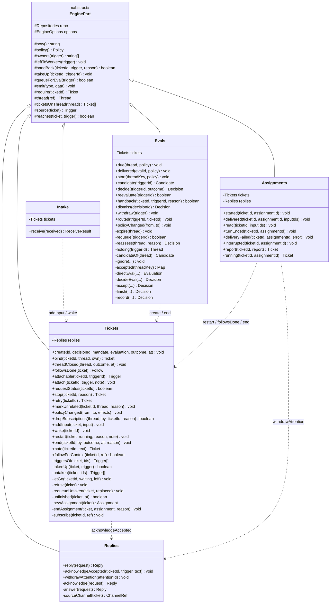
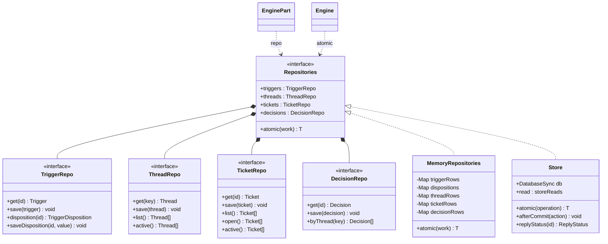
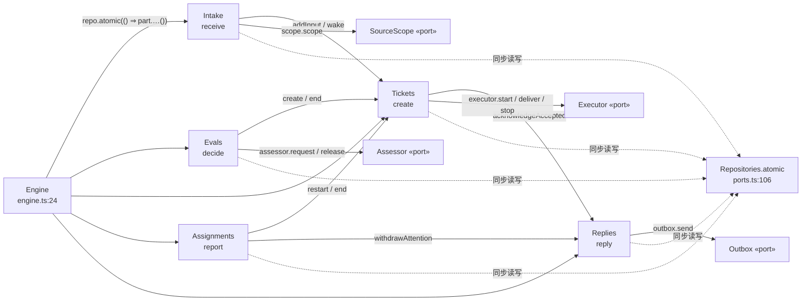

# Parts / Repositories UML — dsh-superagent-prototype

> 源码基准：`/Users/xleo/Agent/way2sa/dsh-superagent-prototype`（发布版研究原型，与长文/内部版不完全相同）。
> 本文每条断言都带 `file:line`，行号以当前工作树为准；`src/...:N` 均相对该仓库根。
> **配套**：同目录 `parts-uml.html`（自包含渲染页，可直接 `file://` 或 Shan 预览打开）、`ENGINE-RUNTIME-UML.md` / `engine-runtime-uml.html`（组合根与事务门的 UML）。
> 本文补的是 `Engine` 内部的 5 个 `EnginePart` 子类 + 它们唯一的状态出口 `Repositories`。

---

## 0. 六个对象的定位

| 对象 | 构造型 | 定义 | 职责（一句话） | 注入的协作者 | public / private 方法 |
| --- | --- | --- | --- | --- | --- |
| `EnginePart` | `«abstract»` | `src/core/part.ts:24` | 5 个子类的共享工具箱：仓储、时钟、策略、事件、聚合读取 | `repo: Repositories`（`:25`）、`options: EngineOptions`（`:26`） | 13 个 `protected` 方法 + 2 字段 |
| `Intake` | `«class»` | `src/core/intake.ts:16` | 接收 Trigger：去重、SourceScope 过滤、线程关联、订阅扇出、入 Eval 队列 | `tickets: Tickets`（`:17`） | 1 / 0 |
| `Evals` | `«class»` | `src/core/evals.ts:27` | Thread 的 Eval 全生命周期：批处理、gate、问 Assessor、超时、记录 Decision | `tickets: Tickets`（`:28`） | 11 / 12 |
| `Tickets` | `«class»` | `src/core/tickets.ts:29` | Ticket 聚合的唯一写者：创建/绑定/附加/唤醒/重启/结束、订阅与 Assignment | `replies: Replies`（`:30`） | 18 / 10 |
| `Assignments` | `«class»` | `src/core/assignments.ts:30` | 记录 Executor/worker 对 Assignment 的回报，驱动 Ticket 的重启与结束 | `tickets: Tickets` + `replies: Replies`（`:31`） | 7 / 1 |
| `Replies` | `«class»` | `src/core/replies.ts:26` | 把消息以确定性 id 幂等排入 `Outbox`；**没有自己的构造器**，继承 `EnginePart(options)` | 无（只用 `options.outbox`） | 3 / 3 |
| `Repositories` | `«interface»` | `src/core/ports.ts:106` | 唯一持久化出口：`atomic()` + 4 组同步仓储，共 17 个方法 | — | 17（含 `atomic`） |

实现 `Repositories` 的有两个：`MemoryRepositories`（`src/core/memory.ts:10`，测试/临时实例，Map 快照回滚）与 `Store`（`src/app/store.ts:51`，生产，`node:sqlite` SAVEPOINT）。运行时由 `Runtime` 在 `src/app/runtime.ts:98` 建 `Store`，在 `:137` 以 `repo: store` 注入 `Engine`。

---

## 1. 五个 Part 的类图（Mermaid）



> 图里的签名做过简化（省略参数类型与联合返回类型），**精确签名见第 4 节**。私有方法用 `-` 标出，`...` 表示参数较多、已在表中列全。

---

## 2. Repositories 接口与实现（Mermaid）



> 4 组仓储在 TS 里是**内联对象类型**，不是具名接口（`ports.ts:108/114/121/129`）；这里为了画图给它们起了 `TriggerRepo` 等名字，属于**表达手段，不是源码里存在的类型**。

---

## 3. 协作与事务边界（Mermaid）



---

## 4. 逐类成员清单（精确签名 + `file:line`）

### 4.1 `EnginePart` — `src/core/part.ts:24`

| 可见性 | 成员 | 行 | 作用 |
| --- | --- | --- | --- |
| `protected readonly` | `repo: Repositories` | `:25` | 所有子类共用的唯一仓储句柄 |
| `protected readonly` | `options: EngineOptions` | `:26` | 构造器参数属性；`EngineOptions` 定义在 `:7-18` |
| `protected` | `now(): string` | `:27` | 可注入时钟，缺省 `new Date().toISOString()` |
| `protected` | `policy(): Policy` | `:28` | 每次调用都读当前策略（不是构造时快照） |
| `protected` | `owners(trigger): string[]` | `:30` | `followupOwners(trigger, repo)` |
| `protected` | `leftToWorkers(trigger): void` | `:32` | 还有 ticket 的 worker 在决定时抛 `UserError('workerDecides')` |
| `protected` | `handBack(ticketId, trigger, reason): boolean` | `:42` | 记 handback，无人再决定时入 Eval 队列 |
| `protected` | `takeUp(ticketId, triggerId): void` | `:50` | 记 `acked`，表示 worker 接住了这条消息 |
| `protected` | `queueForEval(trigger): boolean` | `:57` | 主 Thread 的 `pending` 去重入队 |
| `protected` | `emit(type, data): void` | `:64` | 转发给 `options.emit`（Runtime 提供） |
| `protected` | `require(ticketId): Ticket` | `:67` | 取不到抛 `UserError('unknownTicket')` |
| `protected` | `thread(ref): Thread` | `:69` | 取存储中的 Thread，否则返回**未保存**的空聚合 |
| `protected` | `ticketsOnThread(thread): Ticket[]` | `:73` | 展开 `subscriptions`，跳过已删除的 id |
| `protected` | `source(ticket): Trigger \| undefined` | `:76` | 取 ticket 的原始 Trigger |
| `protected` | `reaches(ticket, trigger, context): boolean` | `:77` | 委托 `model.ts` 的 `reached(...)` |

**关键**：`EnginePart` 没有抽象方法。它不是模板方法基类，而是一个 `protected` 工具箱——5 个子类的 public API 完全不同，共享的只是「怎么读聚合、怎么发事件、怎么拿时钟」。

### 4.2 `Intake` — `src/core/intake.ts:16`

- 构造器 `:17` → `constructor(options, private readonly tickets: Tickets)`
- 唯一 public 方法：`receive(received: Trigger): ReceiveResult`（`:19`），`ReceiveResult = 'stored' | 'duplicate' | 'filtered'`（`:8`）。
- 流程（`:20-61`）：ISO 时间归一 → 至少属于一个 Thread → 去重 → `scope.scope` 过滤（不监听则存 `filtered` disposition 并提前返回）→ 逐 Thread 更新 `lastAt`/`correlated`，收集被触达的 ticket → `tickets.addInput`（`:50`）→ 存 `disposition`（`:55`）→ 无人决定时 `queueForEval`（`:58`）→ `tickets.wake`（`:59`）→ `emit('trigger.received')`（`:60`）。
- **不自己写 Ticket 聚合**，跨聚合的写入一律交给 `Tickets`。

### 4.3 `Evals` — `src/core/evals.ts:27`

`Outcome = AssessmentOutcome & { evalId?: string }`（`:12`）；构造器 `:28` 注入 `tickets`。

| public（11） | 行 | private（12） | 行 |
| --- | --- | --- | --- |
| `due(thread, policy): void` | `:35` | `expire(thread): void` | `:60` |
| `delivered(evalId, policy): void` | `:48` | `requeue(triggerId): boolean` | `:167` |
| `start(threadKeyValue, policy): void` | `:71` | `reassess(thread, reason, without): Decision` | `:223` |
| `candidate(triggerId): Candidate \| undefined` | `:121` | `holding(triggerId): Thread \| undefined` | `:232` |
| `decide(triggerId, outcome): Decision` | `:131` | `candidateOf(thread): Candidate` | `:237` |
| `reevaluate(triggerId): boolean` | `:161` | `ignore(thread, ids, reason, policy, at): void` | `:247` |
| `handback(ticketId, triggerId, reason): boolean` | `:183` | `accepted(threadKey): Map<string, Decision>` | `:258` |
| `dismiss(decisionId): Decision` | `:193` | `directEval(thread, trigger, kind, ticketId?): Evaluation` | `:271` |
| `withdraw(trigger): void` | `:201` | `decideEval(thread, evaluation, outcome): Decision` | `:282` |
| `routed(triggerId, ticketId): void` | `:211` | `accept(thread, evaluation, outcome): Decision` | `:306` |
| `policyChanged(from, to): void` | `:218` | `finish(thread, evaluation, outcome): Decision` | `:318` |
| | | `record(thread, evaluation, outcome): Decision` | `:327` |

用到的端口：`assessor.request`（`:118`）、`assessor.release`（`:68, :324`）、`repo.decisions/threads/triggers/tickets`。发出的事件：`eval.started`、`trigger.followup`、`trigger.requeued`、`policy.changed`、`decision.recorded`（`:117, :83, :163, :220, :337`）。跨聚合写入委托：`tickets.create`（`:314`）、`tickets.end`（`:300`）。

### 4.4 `Tickets` — `src/core/tickets.ts:29`

**最大的一个 Part**：18 public + 10 private。自动输入判定的自由函数 `automatic(input)` 在 `:14`（`Assignments` 会复用）。

| public（18） | 行 | private（10） | 行 |
| --- | --- | --- | --- |
| `create(id, decisionId, mandate, evaluation, outcome, at): void` | `:37` | `triggersOf(ticket, ids?): Trigger[]` | `:272` |
| `bind(ticketId, thread, own): Ticket` | `:61` | `takenUp(ticket, trigger): boolean` | `:280` |
| `threadClosed(thread, outcome, at): void` | `:77` | `untaken(ticket, ids): Trigger[]` | `:285` |
| `followsDone(ticket): Follow['closed']` | `:95` | `letGo(ticketId, waiting, left): void` | `:294` |
| `attachable(ticketId, triggerId): Trigger` | `:106` | `refuse(ticket): void` | `:311` |
| `attach(ticketId, trigger, note?): void` | `:121` | `requeueUntaken(ticket, replaced): void` | `:333` |
| `requestStatus(ticketId): boolean` | `:150` | `unfinished(ticket, at): boolean` | `:370` |
| `stop(ticketId, reason?): Ticket` | `:160` | `newAssignment(ticket): Assignment` | `:381` |
| `retry(ticketId): Ticket` | `:168` | `endAssignment(ticket, assignment, reason): void` | `:387` |
| `markUnrelated(ticketId, thread, reason): void` | `:185` | `subscribe(ticketId, ref): void` | `:417` |
| `policyChanged(from, to, effects): void` | `:200` | | |
| `dropSubscriptions(thread, by, ticketId?, reason?): boolean` | `:214` | | |
| `addInput(ticket, input): void` | `:234` | | |
| `wake(ticketId): void` | `:252` | | |
| `restart(ticket, running, reason, note): void` | `:318` | | |
| `end(ticketId, by, outcome, at?, reason?): void` | `:345` | | |
| `note(ticketId, text): Ticket` | `:395` | | |
| `followForContext(ticketId, ref): boolean` | `:407` | | |

用到的端口：`executor.start`（`:54, :178, :244, :268, :326`）、`executor.deliver`（`:243`）、`executor.stop`（`:177, :362`）、`outbox.status`（`:282`）；`replies.acknowledgeAccepted`（`:53`）。发出的事件：`ticket.created`、`ticket.resumed`、`ticket.ended`、`assignment.ended`、`thread.subscribed`、`thread.unsubscribed`。

### 4.5 `Assignments` — `src/core/assignments.ts:30`

- `WorkerReport` 接口在 `:11-20`（`state / summary / question? / askedBy? / answers?`），`RECOVERY_NOTE` 常量在 `:21`。
- 构造器 `:31` 同时注入 `tickets` 与 `replies`——它是依赖最多的 Part。
- public（7）：`started` `:34`、`delivered` `:48`、`read` `:60`、`turnEnded` `:66`、`deliveryFailed` `:72`、`interrupted` `:83`、`report(ticketId, report): Ticket` `:99`。
- private（1）：`running(ticketId, assignmentId): Ticket \| undefined` `:136`。
- 委派：`tickets.restart`（`:90`）、`tickets.followsDone`（`:129, :131`）、`tickets.end`（`:132`）、`replies.withdrawAttention`（`:121`）、`executor.deliver`（`:41, :91`）；发 `assignment.started`（`:42`）。

### 4.6 `Replies` — `src/core/replies.ts:26`

- `ReplyRequest` 判别联合在 `:14`、`Reply` 接口在 `:18`。
- **没有声明构造器**，直接继承 `EnginePart(options)`；因此它不持有任何兄弟 Part，是依赖图的叶子。
- public（3）：`reply(request): Reply` `:36`、`acknowledgeAccepted(ticketId, trigger, text): void` `:43`、`withdrawAttention(attentionId): void` `:47`。
- private（3）：`acknowledge` `:48`、`answer` `:64`、`sourceChannel(ticket): ChannelRef \| undefined` `:94`。
- 只用 `Outbox`：`send`（`:44, :60, :86`）、`status`（`:57, :62, :80, :91`）、`withdraw`（`:47`）；`repo.tickets.list/save`（`:68, :89`）、`repo.triggers.get`（`:51, :65, :83`）。
- `reply()` 的幂等靠确定性 id（`key(...)`）+ `outbox.status` 判定，已在 `:20-24` 的类注释里写明。

### 4.7 `Repositories` — `src/core/ports.ts:106`

> 类注释（`:105`）："Durable state. Every method is synchronous so `atomic` can wrap a unit of work."

| 组 | 行 | 方法 |
| --- | --- | --- |
| `atomic<T>(work: () => T): T` | `:107` | 事务门，唯一非同步业务入口 |
| `triggers` | `:108-113` | `get(id) → Trigger \| undefined`、`save(trigger)`、`disposition(id) → TriggerDisposition \| undefined`、`saveDisposition(id, value)` |
| `threads` | `:114-120` | `get(key) → Thread \| undefined`、`save(thread)`、`list()`、`active()`（有 pending 或正在 Eval） |
| `tickets` | `:121-128` | `get(id)`、`save(ticket)`、`list()`、`open()`、`active()`（有未投递 Input 或最新 Assignment 在 pending/running） |
| `decisions` | `:129-133` | `get(id)`、`save(decision)`、`byThread(key)` |

合计 **17 个方法**（1 + 4 + 4 + 5 + 3）。全部同步，这是 `atomic()` 能包住整个 unit of work 的前提。

**`Store`（`src/app/store.ts:51`）**：`implements Repositories`。`atomic` 在 `:140-153`，用 `SAVEPOINT / RELEASE / ROLLBACK TO` 支持**嵌套事务**，`depth` 计数；`afterCommit`（`:159`）把回调排到最外层提交之后，回滚则丢弃。四组仓储分别是 `:201 / :210 / :233 / :243` 的 `readonly` 对象字面量，其中 `threads` 还多出 `describe` / `patchMeta`（`:216, :225`），`tickets` 的 `list/open/active` 都按 `rowid DESC` 返回最新在前。额外能力（KV、settings、receipts、`read`）不属于 `Repositories` 接口，是 `src/app/` 自己用的。

**`MemoryRepositories`（`src/core/memory.ts:10`）**：5 个 `Map` + `structuredClone`（`:5`），`atomic` 在 `:16-24`：**先给 5 个 Map 拍快照，异常时逐个 `clear` 再回填**。类注释（`:6-9`）明确写了它「matches the ordering semantics of the SQLite store for Engine tests」——`tickets.list()` 用 `.reverse()` 对齐 SQLite 的 `ORDER BY rowid DESC`（`:40-41`）。

### 4.8 装配证据

```ts
// src/core/engine.ts:31-38 —— 构造顺序就是依赖拓扑序
this.replies     = new Replies(options)                              // :33 叶子
this.tickets     = new Tickets(options, this.replies)                // :34
this.assignments = new Assignments(options, this.tickets, this.replies) // :35
this.evals       = new Evals(options, this.tickets)                   // :36
this.intake      = new Intake(options, this.tickets)                  // :37

// src/app/runtime.ts:98 / :137
const store = opened = this.store = new Store(join(machine.stateDir, 'orchestrator.sqlite'), report)
const engine = this.engine = new Engine({ repo: store, scope: sources, policy, assessor, executor, ... })
```

---

## 5. 跨 Part 调用矩阵（谁调谁，带行号）

| 调用方 | 被调方 | 方法 | 证据 |
| --- | --- | --- | --- |
| `Intake` | `Tickets` | `addInput` / `wake` | `intake.ts:50, :59` |
| `Intake` | `SourceScope` | `scope` | `intake.ts:25` |
| `Evals` | `Tickets` | `create` / `end` | `evals.ts:314, :300` |
| `Evals` | `Assessor` | `request` / `release` | `evals.ts:118, :68, :324` |
| `Tickets` | `Replies` | `acknowledgeAccepted` | `tickets.ts:53` |
| `Tickets` | `Executor` | `start` / `deliver` / `stop` | `tickets.ts:54,178,244,268,326 / :243 / :177,362` |
| `Tickets` | `Outbox` | `status` | `tickets.ts:282` |
| `Assignments` | `Tickets` | `restart` / `followsDone` / `end` | `assignments.ts:90 / :129,131 / :132` |
| `Assignments` | `Replies` | `withdrawAttention` | `assignments.ts:121` |
| `Assignments` | `Executor` | `deliver` | `assignments.ts:41, :91` |
| `Replies` | `Outbox` | `send` / `status` / `withdraw` | `replies.ts:44,60,86 / :57,62,80,91 / :47` |
| 全部 5 个 Part | `Repositories` | `triggers` / `threads` / `tickets` / `decisions` | 通过继承的 `this.repo`（`part.ts:25`） |

依赖是 **DAG，无环**：`Intake / Evals / Assignments → Tickets → Replies → Outbox`；`Replies` 不回指任何兄弟 Part。`engine.ts:33-37` 的构造顺序恰好是这个拓扑序。

---

## 6. 关系语义（图例）

| UML 关系 | 本图里的含义 | 证据 |
| --- | --- | --- |
| 泛化（实线空心三角） | 5 个 `class X extends EnginePart` | `intake.ts:16`、`evals.ts:27`、`tickets.ts:29`、`assignments.ts:30`、`replies.ts:26` |
| 实现（虚线空心三角） | `Store` / `MemoryRepositories` → `Repositories` | `store.ts:51`、`memory.ts:10` |
| 组合（实心菱形） | `Engine` 拥有 5 个 Part；`Repositories` 拥有 4 组仓储 | `engine.ts:33-37`、`ports.ts:108-133` |
| 依赖（虚线箭头） | Part → 兄弟 Part / 端口，构造器参数属性 | 第 5 节矩阵 |
| 注释 | 4 组具名 `XxxRepo` 是画图用的别名，源码里是内联对象类型 | `ports.ts:108/114/121/129` |

---

## 7. 从这六张图读出的设计决策

1. **五个 Part 是同一事务里的分工，不是五个服务**。`Engine` 在构造器里把它们全部 `new` 出来，共享同一个 `EngineOptions` 与同一个 `repo` 句柄（`engine.ts:31-38`）；任何一个都没有独立生命周期，也没有自己的 `atomic()`。
2. **唯一的事务门在 Engine**。`Engine` 的 27 个 public 方法里 26 个是 `return this.repo.atomic(() => this.<part>.<method>(...))`（`engine.ts:48` 起），唯一例外是只读 `candidate()`（`:90`）。Part 本身从不开启事务，因此可以安全地互相调用而不产生嵌套提交问题——`Store.atomic` 的 SAVEPOINT 嵌套只是额外保险。
3. **基类是工具箱，不是模板方法**。`EnginePart` 没有抽象方法，13 个 `protected` 方法全是读写辅助；子类的 public API 完全由各自领域决定（1 / 11 / 18 / 7 / 3 个方法）。
4. **跨聚合写必须委托兄弟 Part**。`part.ts:20-23` 的类注释把这条规则写明了；实证是 `Evals.accept()` 调 `tickets.create`（`evals.ts:314`）、`Evals` 的 stop 调 `tickets.end`（`:300`）、`Assignments.report()` 调 `tickets.restart/end`。因此「Ticket 聚合只有一个写者」是**约定 + 代码结构**保证的，不是靠运行时检查。
5. **副作用不进核心**。`Executor` / `Assessor` / `Outbox` 都只「排队」（`ports.ts:55-58, :75-83` 注释），`DomainEvents` 通过 `options.emit` 交给 Runtime 翻译（`part.ts:64-66`）。核心层因此可以直接被 `MemoryRepositories` 驱动做单元测试。
6. **两个仓储实现语义等价是可测性的前提**。`MemoryRepositories` 专门复制了 SQLite 的排序语义（`memory.ts:40-41`），说明「核心不依赖具体 DB」不只是编译期接口隔离，连行为都做了对齐。
7. **`active()` / `open()` 是给轮询用的工作集**。`threads.active` / `tickets.active` 在 SQLite 里由生成列 + 部分索引实现（`store.ts:30-43, :214, :241`），在内存实现里由 `filter` 实现（`memory.ts:35, :43`）——接口相同、成本模型不同，这正是端口抽象的价值。

---

## 8. 可复用的 PlantUML 源

```plantuml
@startuml
skinparam classAttributeIconSize 0
package "src/core (pure domain)" {
  abstract class EnginePart {
    # {readonly} repo : Repositories
    # {readonly} options : EngineOptions
    # now() : string
    # policy() : Policy
    # owners(trigger) : string[]
    # handBack(ticketId, trigger, reason) : boolean
    # queueForEval(trigger) : boolean
    # emit(type, data) : void
    # require(ticketId) : Ticket
    # thread(ref) : Thread
    # reaches(ticket, trigger) : boolean
  }
  class Intake { + receive(received) : ReceiveResult }
  class Evals  { + decide(triggerId, outcome) : Decision
                 + start(threadKey, policy) : void }
  class Tickets { + create(...) : void
                  + addInput(ticket, input) : void
                  + end(ticketId, by, outcome) : void }
  class Assignments { + report(ticketId, report) : Ticket }
  class Replies { + reply(request) : Reply }
  interface Repositories {
    + atomic(work) : T
    + triggers
    + threads
    + tickets
    + decisions
  }
  class MemoryRepositories
  interface Outbox { + send(message) : void }
  interface Executor { + start(ticket, assignment) : void }
  interface Assessor { + request(candidate) : void }
}
package "src/app (I/O)" {
  class Store { + atomic(operation) : T }
}

EnginePart <|-- Intake
EnginePart <|-- Evals
EnginePart <|-- Tickets
EnginePart <|-- Assignments
EnginePart <|-- Replies
Repositories <|.. Store
Repositories <|.. MemoryRepositories
EnginePart --> Repositories : repo
Intake ..> Tickets : addInput / wake
Evals ..> Tickets : create / end
Tickets ..> Replies : acknowledgeAccepted
Assignments ..> Tickets : restart / end
Assignments ..> Replies : withdrawAttention
Replies ..> Outbox : send
Tickets ..> Executor : start / deliver / stop
Evals ..> Assessor : request / release
@enduml
```

---

## 9. 与课程 UML 目录的关系

`way2sa/assets/uml.js` 里已有这 6 个 id 的**精简条目**（用于课件里点图块弹窗，通常 3 字段 / 5 方法），本文和 `parts-uml.html` 是**完整版**。两者不冲突：目录是「讲课用的索引」，这里是「读源码用的坐标表」。若要让弹窗显示完整成员，改 `assets/uml.js` 对应条目后 `node tools/build.mjs` 重建 9 个页面即可。

**已知口径限制**：
- 第 1、2 节的 Mermaid 签名做了简化；精确签名以第 4 节为准。
- 4 组 `XxxRepo` 是画图别名，源码中不存在这些具名类型。
- 行号基于当前工作树；改动 `src/core/` 后需重新核对。
